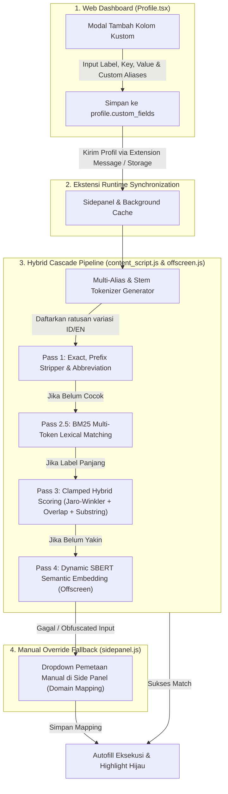

# Rencana Implementasi: Integrasi Penuh Kolom Kustom ke dalam Hybrid Cascade Pipeline GovConnect

> [!NOTE]
> **Tujuan Dokumen:** Mengubah status Kolom Kustom (*Custom Fields*) dari sekadar catatan data pasif di Dasbor menjadi elemen aktif yang dideteksi, dinilai, dan diisikan secara otomatis dan akurat oleh **Hybrid Cascade Pipeline** pada ekstensi browser GovConnect.

---

## 1. Latar Belakang & Analisis Akar Masalah (*Root Cause Analysis*)

Berdasarkan evaluasi terhadap basis kode saat ini, ditemukan 4 kendala utama yang menyebabkan Kolom Kustom tidak terdeteksi pada formulir web:

```
┌────────────────────────────────────────────────────────────────────────┐
│             Hambatan Saat Ini pada Deteksi Kolom Kustom                │
└───────────────────────────────────┬────────────────────────────────────┘
                                    │
    ┌───────────────────────────────┼───────────────────────────────┐
    ▼                               ▼                               ▼
[Leksikal Terlalu Kaku]     [Pass 3 Terdiskriminasi]       [Pass 4 SBERT Buta]
KEYWORD_MAP hanya catat     54 core keys dapat bonus       Vektor embedding hanya
exact key & exact label.    konteks (+0.25 s/d +0.40).    di-precompute untuk 54
Variasi form web (ID/EN)    Skor custom field selalu       anchor keys. Custom
pasti luput (miss).         kalah di bawah threshold.      fields tidak dikenal AI.
```

1. **Pendaftaran Kata Kunci yang Terlalu Minimalis di `content_script.js`**:
   - Saat ini `registerCustomProfileFields()` hanya mendaftarkan:
     `KEYWORD_MAP[key] = [key, keyWithoutUnderscore, cleanLabel, label]`.
   - Jika pengguna membuat kolom *"Nomor Paspor"* (`nomor_paspor`), sedangkan web formulir menggunakan `<input name="passport">`, `<input id="no_paspor">`, atau `placeholder="Passport Number"`, sistem gagal total karena tidak ada variasi kata kunci atau sinonim.
2. **Ketiadaan *Context Bonus* pada Pass 3 (*Hybrid Scoring*)**:
   - 54 *Core Profile Keys* memiliki puluhan aturan penambah skor (*context bonus*) berbasis token semantik. Kolom kustom tidak memiliki penguat skor, sehingga sering kali nilainya berada di bawah ambang batas deteksi ($\text{Score} < 0.60$).
3. **Penyekatan pada Pass 4 (*Sentence-BERT Semantic Fallback* di `offscreen.js`)**:
   - Matriks vektor referensi SBERT 384-dimensi hanya mencakup 54 kunci kanonikal (`PROFILE_KEY_LABELS`).
   - SBERT di WebAssembly *offscreen* sama sekali tidak mengetahui keberadaan kolom kustom pengguna.
4. **Formulir Profil Belum Menyediakan Konfigurasi Kata Kunci/Alias**:
   - Modal Tambah Kolom Kustom di `Profile.tsx` hanya meminta *Nama Kolom*, *Kunci*, dan *Nilai*. Tidak ada masukan untuk alias/variasi kata kunci form di dunia nyata.

---

## 2. Arsitektur Target & Alur Data



---

## 3. Rencana Kerja Terperinci (Tahapan Implementasi)

### Tahap 1: Peningkatan Skema Data & Antarmuka Dasbor (`frontend/src/pages/Profile.tsx`)
* **Tujuan:** Memungkinkan pengguna memasukkan alias deteksi, atau sistem membuatkan alias otomatis secara cerdas.
1. **Modifikasi Struktur Data Kolom Kustom**:
   - Memperluas antarmuka `CustomFieldItem`:
     ```typescript
     export interface CustomFieldItem {
       id: string;
       category: string;
       key: string;
       label: string;
       value: string;
       type: string;
       aliases?: string[]; // Kata kunci form tambahan (misal: ["passport", "no_paspor", "passport_no"])
     }
     ```
2. **Penambahan Field Input di Modal Tambah & Edit Kolom Kustom**:
   - Tambah input: **"Kata Kunci / Variasi Formulir (Opsional)"**.
   - Dilengkapi *chip input* atau teks pisahan koma dengan *placeholder*: `Contoh: paspor, passport, no_paspor, passport_number`.
3. **Auto-Suggester Alias Cerdas Berdasarkan Label**:
   - Saat user mengetik nama kolom (misal: *"Nomor Pokok Siswa"*), sistem secara otomatis menyiapkan saran alias umum (misal: `["npsn", "nomor_siswa", "school_student_id"]`) yang bisa langsung diklik pengguna.

---

### Tahap 2: Mesin Generator Kata Kunci & Tokenisasi Dinamis (`extension/content_script.js`)
* **Tujuan:** Memperkaya penapisan Pass 1, Pass 2, dan Pass 2.5 agar kolom kustom memiliki daya tangkap leksikal setara dengan 54 core keys.
1. **Penyempurnaan `registerCustomProfileFields(profile)`**:
   - Membuat fungsi pembantu `generateCustomFieldKeywords(item)`:
     - Mengurai label menjadi kata tunggal dan kombinasi bi-gram: *"Nomor Izin Usaha"* $\to$ `nomor`, `izin`, `usaha`, `izin_usaha`, `nomor_izin`, `no_izin`.
     - Menghasilkan variasi singkatan umum bahasa Indonesia:
       - `nomor` $\leftrightarrow$ `no`, `nomor_` $\leftrightarrow$ `no_`, `kd_` $\leftrightarrow$ `kode`.
       - `tanggal` $\leftrightarrow$ `tgl`, `telepon` $\leftrightarrow$ `telp` / `tlp`.
     - Menggabungkan daftar `aliases` eksplisit yang diset pengguna di Dasbor.
     - Mendaftarkan semua variasi tersebut ke dalam `KEYWORD_MAP[item.key]`.
2. **Penyesuaian Pass 2 (*Context Modifiers & Veto Scope*)**:
   - Memastikan aturan veto (seperti `hasTanggal && !hasLahir`) tidak langsung me-return `null` jika ada kolom kustom tanggal yang cocok.
3. **Penyesuaian Pass 3 (*Hybrid Scoring*)**:
   - Memberikan *Custom Field Affinity Boost* (+0.20) pada kalkulasi skor gabungan ketika token unik dari label kolom kustom memiliki *high-overlap* pada label elemen input web.

---

### Tahap 3: Dynamic Embedding di AI Semantic Fallback (`extension/offscreen.js`)
* **Tujuan:** Memungkinkan Sentence-BERT mengenali makna kolom kustom meskipun kata-katanya berbeda (misal form menulis *"ID Registrasi Pemilik"* dan kolom kustom bernama *"Nomor Izin Usaha"*).
1. **Memperluas `getReferenceEmbeddings(extractor)`**:
   - Memisahkan cache menjadi dua: `static54Embeddings` dan `dynamicCustomEmbeddings`.
2. **Pesan Sinkronisasi Profil ke Offscreen**:
   - Ketika ada event `PROFILE_UPDATED` atau `SET_CACHED_PROFILE`, `offscreen.js` mengekstrak semua `custom_fields` yang memiliki label.
   - Menghitung embedding untuk label-label kustom tersebut menggunakan `extractor(customLabels)` secara *batch* di background (hanya butuh ~10-20ms untuk beberapa custom fields).
   - Menggabungkan vektor custom field ke dalam daftar kandidat *cosine similarity* di Pass 4.

---

### Tahap 4: Integrasi Side Panel & Manual Field Mapping (`extension/sidepanel.js`)
* **Tujuan:** Sebagai *fail-safe* jika form web target menggunakan nama acak/terobfusikasi (seperti `input_123_xyz`).
1. **Visualisasi Kolom Kustom di Checklist Deteksi**:
   - Menampilkan *badge* khusus (misal warna ungu lembut bertuliskan `Kustom`) di samping nama field pada Side Panel agar pengguna langsung tahu bahwa kolom tersebut berasal dari Kolom Kustom miliknya.
2. **Dropdown "Petakan Ulang / Override"**:
   - Jika ada baris yang berstatus `Belum Terpetakan / Tidak Dikenali`, pengguna dapat mengklik dropdown dan memilih salah satu Kolom Kustom miliknya.
   - Memanfaatkan backend endpoint `/api/v1/mappings` untuk menyimpan selektor DOM tersebut, sehingga pada kunjungan berikutnya ke web tersebut, kolom kustom langsung terisi 100% otomatis.

---

## 4. Matriks Perbandingan Sebelum vs Sesudah

| Kriteria / Skenario | Keadaan Sekarang (Sebelum) | Keadaan Setelah Rencana Ini (Sesudah) |
| :--- | :--- | :--- |
| **Pencocokan Nama Kolom** | Hanya cocok jika nama/id input persis sama dengan key kolom kustom. | Mengenali puluhan variasi nama input, singkatan (`no_`, `tgl_`), serta terjemahan Inggris/Indonesia. |
| **Pencocokan Semantik (Pass 4)** | **Buta (0%)** — SBERT hanya mengetahui 54 kunci inti. | **Aktif (100%)** — SBERT secara dinamis menghitung vektor label kolom kustom pengguna. |
| **Input Kata Kunci di Dasbor** | Tidak ada. Pengguna tidak bisa menentukan alias form. | Ada input variasi kata kunci form di modal profil pengguna. |
| **Form Web Liar / Terobfusikasi** | Gagal dan tidak bisa diisi sama sekali. | Dapat dipetakan sekali klik di Side Panel lalu diingat permanen melalui *Domain Mapping*. |
| **Performa Pipeline** | Cepat tapi sering *miss* untuk data non-standar. | Tetap sub-milidetik (<5ms) untuk leksikal; inferensi AI semantik hanya aktif sebagai *fallback*. |

---

## 5. Rencana Pengujian & Validasi

1. **Uji Coba Leksikal (Unit Test / Regex & Tokenizer)**:
   - Membuat custom field: Label *"Nomor Paspor"*, Alias: `["passport", "no_paspor", "passport_no"]`.
   - Menguji di `dummy_form.html` dengan elemen `<input name="passport_number">` $\to$ Harus terdeteksi dengan status `matched`.
2. **Uji Coba SBERT Semantic Offscreen**:
   - Membuat custom field: Label *"Pendidikan Tertinggi Ibu"*.
   - Menguji input dengan label: *"Jenjang Sekolah Terakhir Orang Tua Perempuan"* $\to$ Harus terpetakan ke kolom kustom via Pass 4.
3. **Uji Coba Regresi 54 Core Keys**:
   - Memastikan ke-54 kunci kanonikal (NIK, Nama, Tanggal Lahir, Email, dll.) tidak terganggu akurasinya dan tidak terjadi tabrakan positif palsu (*false positive*).

---

## 6. Keputusan & Masukan yang Dibutuhkan

Sebelum memulai penulisan kode implementasi, mohon konfirmasi mengenai:
1. **Apakah tata letak input alias di Modal Profil Dasbor sudah sesuai dengan preferensi Anda?** (Misal: input teks sederhana dipisahkan koma atau dalam bentuk *tag/chip pill*).
2. **Apakah Anda setuju kita mulai eksekusi dari Tahap 1 (Dasbor & Schema) dan Tahap 2 (Ekstensi `content_script.js`) terlebih dahulu?**
