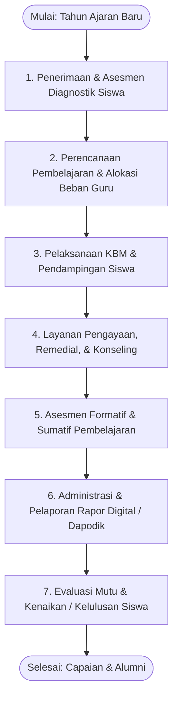
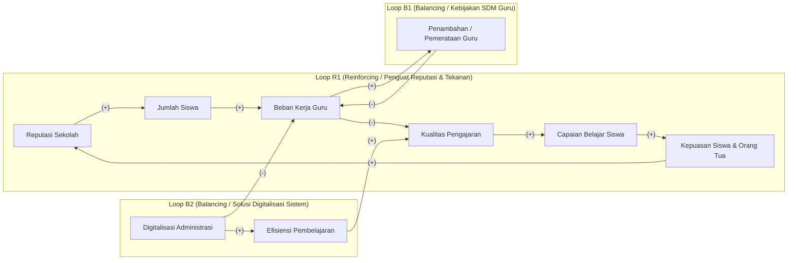

# LAPORAN PEMODELAN SISTEM
## SISTEM PEMBELAJARAN DI SEKOLAH DALAM MENDUKUNG SUSTAINABLE DEVELOPMENT GOAL 4 (QUALITY EDUCATION)

---

**Disusun Oleh :**  
**Kelompok 5**  
1. Mohammad Thoriq Febri — 07.2024.1.03917  
2. Mohammad Azmi AL — 07.2024.1.03977  
3. Berliana Ajeng — 07.2024.1.03951  
4. Hirzan Rafdi AL — 07.2024.1.03953  
5. Radithya Ramadhan — 07.2024.1.03967  
6. Anak Agung Bagus — 07.2024.1.03949  

**PROGRAM STUDI TEKNIK INDUSTRI**  
**FAKULTAS TEKNOLOGI INDUSTRI**  
**INSTITUT TEKNOLOGI ADHI TAMA SURABAYA**  
**2025**

---

## DAFTAR ISI

- [DAFTAR ISI](#daftar-isi)
- [DAFTAR GAMBAR](#daftar-gambar)
- [DAFTAR TABEL](#daftar-tabel)
- [BAB I PENDAHULUAN](#bab-i-pendahuluan)
  - [1.1 Latar Belakang](#11-latar-belakang)
  - [1.2 Tujuan Penelitian](#12-tujuan-penelitian)
  - [1.3 Manfaat Penelitian](#13-manfaat-penelitian)
  - [1.4 Keterkaitan dengan Sustainable Development Goals (SDGs)](#14-keterkaitan-dengan-sustainable-development-goals-sdgs)
    - [1.4.1 SDG 4.1 Akses dan Mutu Pendidikan Dasar dan Menengah](#141-sdg-41-akses-dan-mutu-pendidikan-dasar-dan-menengah)
    - [1.4.2 SDG 4.c Peningkatan Pasokan dan Kualifikasi Guru Berkualitas](#142-sdg-4c-peningkatan-pasokan-dan-kualifikasi-guru-berkualitas)
    - [1.4.3 SDG 4.a Penguatan Fasilitas dan Lingkungan Belajar yang Aman dan Inklusif](#143-sdg-4a-penguatan-fasilitas-dan-lingkungan-belajar-yang-aman-dan-inklusif)
- [BAB II DESKRIPSI SISTEM DAN PERMASALAHAN](#bab-ii-deskripsi-sistem-dan-permasalahan)
  - [2.1 Deskripsi Sistem](#21-deskripsi-sistem)
    - [2.1.1 Input Sistem (Sumber Daya Masukan)](#211-input-sistem-sumber-daya-masukan)
    - [2.1.2 Proses Sistem (Alur Pembelajaran dan Layanan Pendidikan)](#212-proses-sistem-alur-pembelajaran-dan-layanan-pendidikan)
    - [2.1.3 Output Sistem (Hasil Layanan Pendidikan)](#213-output-sistem-hasil-layanan-pendidikan)
    - [2.1.4 Stakeholder (Pemangku Kepentingan Sistem)](#214-stakeholder-pemangku-kepentingan-sistem)
  - [2.2 Permasalahan](#22-permasalahan)
- [BAB III METODOLOGI PENYELESAIAN STUDI KASUS](#bab-iii-metodologi-penyelesaian-studi-kasus)
  - [3.1 Identifikasi Sistem](#31-identifikasi-sistem)
  - [3.2 Identifikasi Permasalahan](#32-identifikasi-permasalahan)
  - [3.3 Pendekatan Soft System Methodology (SSM)](#33-pendekatan-soft-system-methodology-ssm)
  - [3.4 Output yang Dihasilkan](#34-output-yang-dihasilkan)
- [BAB IV ANALISIS SISTEM MENGGUNAKAN SOFT SYSTEM METHODOLOGY (SSM)](#bab-iv-analisis-sistem-menggunakan-soft-system-methodology-ssm)
  - [4.1 Rich Picture](#41-rich-picture)
  - [4.2 Analisis CATWOE](#42-analisis-catwoe)
  - [4.3 Root Definition](#43-root-definition)
- [BAB V MODEL KONSEPTUAL SISTEM PEMBELAJARAN SEKOLAH](#bab-v-model-konseptual-sistem-pembelajaran-sekolah)
  - [5.1 Variabel Kunci Sistem](#51-variabel-kunci-sistem)
  - [5.2 Hubungan Antar Variabel](#52-hubungan-antar-variabel)
    - [5.2.1 Hubungan Positif / Sejalan (+)](#521-hubungan-positif--sejalan-)
    - [5.2.2 Hubungan Negatif / Berlawanan (-)](#522-hubungan-negatif--berlawanan--)
  - [5.3 Dinamika Sistem (Interaksi Loop)](#53-dinamika-sistem-interaksi-loop)
- [BAB VI MODEL MATEMATIS SEDERHANA (LINEAR PROGRAMMING)](#bab-vi-model-matematis-sederhana-linear-programming)
  - [6.1 Variabel Penyusun Model Matematis](#61-variabel-penyusun-model-matematis)
  - [6.2 Formulasi Model Matematis (Linear Programming)](#62-formulasi-model-matematis-linear-programming)
  - [6.3 Solusi Optimal dan Analisis Hasil](#63-solusi-optimal-dan-analisis-hasil)
- [BAB VII KESIMPULAN DAN SARAN PENGEMBANGAN MODEL](#bab-vii-kesimpulan-dan-saran-pengembangan-model)
  - [7.1 Kesimpulan](#71-kesimpulan)
  - [7.2 Saran dan Pengembangan Model](#72-saran-dan-pengembangan-model)
    - [7.2.1 Perbaikan Sistem Operasional dan Teknologi](#721-perbaikan-sistem-operasional-dan-teknologi)
    - [7.2.2 Manajemen Sumber Daya Manusia dan Beban Kerja Guru](#722-manajemen-sumber-daya-manusia-dan-beban-kerja-guru)
    - [7.2.3 Pengembangan Model Selanjutnya](#723-pengembangan-model-selanjutnya)
- [DAFTAR PUSTAKA](#daftar-pustaka)

---

## DAFTAR GAMBAR

- **Gambar 2.1** Diagram Alir Pelayanan dan Pembelajaran di Sekolah
- **Gambar 4.1** Rich Picture Situasi Permasalahan Sistem Pembelajaran Sekolah
- **Gambar 5.1** Causal Loop Diagram (CLD) Sistem Pembelajaran Sekolah

---

## DAFTAR TABEL

- **Tabel 4.1** Analisis CATWOE Sistem Pembelajaran di Sekolah
- **Tabel 6.1** Ringkasan Parameter dan Pemanfaatan Kendala Linear Programming

---

# BAB I  
# PENDAHULUAN

### 1.1 Latar Belakang
Pendidikan merupakan pilar fundamental dalam meningkatkan taraf kesejahteraan masyarakat dan menjadi motor penggerak pembangunan manusia yang berkelanjutan. Kebutuhan akan pendidikan bermutu merupakan hak mendasar bagi setiap warga negara untuk mengembangkan potensi diri dan berpartisipasi aktif dalam kehidupan berbangsa. Dalam konteks formal, sekolah berfungsi sebagai institusi pelayanan publik utama yang bertugas menyelenggarakan proses transmisi ilmu pengetahuan, pembentukan karakter, serta penanaman keterampilan dasar (OECD, 2023).

Namun, realitas operasional di institusi sekolah menunjukkan berbagai tantangan sistemik yang kompleks. Berdasarkan data evaluasi Asesmen Nasional dan laporan PISA (Programme for International Student Assessment), kualitas capaian belajar siswa di Indonesia masih menghadapi tantangan serius, terutama pada kompetensi literasi dan numerasi (Kemendikbudristek, 2023). Salah satu faktor penyebab dominan adalah ketimpangan rasio guru terhadap siswa serta tingginya beban kerja non-mengajar yang harus ditanggung oleh para pendidik.

Tenaga pendidik tidak hanya bertugas melakukan interaksi pedagogis di dalam kelas, tetapi juga dibebani oleh tugas administratif yang sangat menyita waktu, seperti pengisian instrumen data pokok pendidikan (Dapodik), penyusunan berkas evaluasi kinerja, penginputan rapor digital, serta pelaporan manajerial lainnya yang sering kali belum terpadu (Suryadi & Pratama, 2024). Ketika sistem informasi pendukung belum terintegrasi secara harmonis, guru mengalami fragmentasi waktu kerja, kelelahan (*burnout*), dan berkurangnya atensi terhadap kebutuhan individual siswa.

Situasi tersebut berakibat langsung pada penurunan kualitas pengajaran di kelas, lambatnya penanganan kesulitan belajar siswa, serta penurunan kepuasan siswa dan orang tua terhadap layanan pendidikan formal. Untuk mengatasi kompleksitas masalah yang melibatkan banyak pihak dengan kepentingan yang berbeda ini, diperlukan pendekatan pemodelan sistem yang komprehensif. Pendekatan *Soft Systems Methodology* (SSM) dipadukan dengan teknik optimasi *Linear Programming* (LP) sangat relevan untuk memetakan situasi dunia nyata, menstrukturkan masalah, dan merumuskan intervensi alokasi sumber daya sekolah secara optimal.

---

### 1.2 Tujuan Penelitian
Berdasarkan latar belakang di atas, tujuan penelitian ini adalah:
1. Mengidentifikasi komponen-komponen utama dan dinamika keterkaitan dalam sistem pelayanan pembelajaran di sekolah.
2. Menganalisis interaksi antar-pemangku kepentingan dan merumuskan struktur permasalahan menggunakan pendekatan *Soft Systems Methodology* (SSM).
3. Memformulasikan model optimasi matematis sederhana (*Linear Programming*) untuk mengoptimalkan alokasi sumber daya (guru, digitalisasi sistem, dan pelatihan) guna memaksimalkan mutu dan capaian pembelajaran.

---

### 1.3 Manfaat Penelitian
Manfaat yang diharapkan dari penelitian ini meliputi:
- **Bagi Siswa dan Orang Tua:** Memperoleh pengalaman belajar yang berkualitas, interaktif, dan berkeadilan melalui penanganan kesulitan belajar yang tepat waktu serta layanan pendidikan yang transparan.
- **Bagi Manajemen Sekolah dan Guru:** Memberikan kerangka kerja operasional yang menyeimbangkan beban kerja guru, mengurangi beban administrasi melalui digitalisasi terpadu, dan menyediakan acuan alokasi anggaran yang berbasis data.
- **Bagi Pemerintah (Dinas Pendidikan dan Kemendikdasmen):** Menyediakan rekomendasi kebijakan sistemik dalam pemenuhan kualifikasi tenaga pendidik, integrasi arsitektur sistem informasi pendidikan, serta percepatan pencapaian target SDG 4 di tingkat daerah maupun nasional.

---

### 1.4 Keterkaitan dengan Sustainable Development Goals (SDGs)
Seluruh sasaran pembangunan pendidikan dalam kerangka global diintegrasikan pada **SDG 4: Quality Education**, yang bertujuan untuk *“Menjamin kualitas pendidikan yang inklusif dan merata serta mempromosikan kesempatan belajar sepanjang hayat untuk semua”* (UNESCO, 2023). Sistem operasional sekolah berkorelasi langsung dengan tiga indikator utama SDG 4, yaitu:

#### 1.4.1 SDG 4.1 Akses dan Mutu Pendidikan Dasar dan Menengah
Fokus indikator ini memastikan seluruh anak menyelesaikan pendidikan dasar dan menengah yang gratis, setara, dan bermutu hingga menghasilkan capaian belajar yang relevan dan efektif.  
*Contoh implementasi di Indonesia:*
- **Program Bantuan Operasional Satuan Pendidikan (BOSP):** Menjamin operasional dasar sekolah agar beban biaya tidak dibebankan kepada peserta didik, khususnya keluarga pra-sejahtera.
- **Implementasi Kurikulum Merdeka dan Asesmen Nasional (AN):** Menggeser fokus pendidikan dari sekadar hafalan menjadi penguasaan kompetensi nalar mendalam melalui literasi, numerasi, dan survei karakter.
- **Program Indonesia Pintar (PIP):** Bantuan tunai langsung bagi siswa dari keluarga rentan untuk memitigasi risiko putus sekolah.

#### 1.4.2 SDG 4.c Peningkatan Pasokan dan Kualifikasi Guru Berkualitas
Fokus target ini adalah secara substansial meningkatkan jumlah dan kualifikasi guru berdaya saing melalui pelatihan berkelanjutan dan pemerataan distribusi tenaga pengajar.  
*Contoh implementasi di Indonesia:*
- **Pendidikan Profesi Guru (PPG) Prajabatan dan Dalam Jabatan:** Standardisasi sertifikasi pendidik guna menjamin kompetensi pedagogik dan profesionalisme guru.
- **Program Guru Penggerak (PGP):** Pelatihan kepemimpinan pembelajaran untuk mendorong paradigma pengajaran yang berorientasi penuh pada murid.
- **Pengadaan Guru ASN PPPK:** Mekanisme penyerapan guru honorer menjadi aparatur sipil negara demi pemerataan kuota guru di sekolah negeri dan daerah 3T.

#### 1.4.3 SDG 4.a Penguatan Fasilitas dan Lingkungan Belajar yang Aman dan Inklusif
Fokus target ini adalah membangun dan meningkatkan sarana fisik dan digital pendidikan yang ramah anak, ramah disabilitas, sensitif gender, serta menyediakan lingkungan belajar yang aman dan inklusif.  
*Contoh implementasi di Indonesia:*
- **Dana Alokasi Khusus (DAK) Fisik Pendidikan:** Renovasi gedung kelas, laboratorium sains, dan perpustakaan sekolah.
- **Digitalisasi Sekolah:** Bantuan perangkat TIK (Chromebook/laptop edukasi) serta akses internet bagi sekolah-sekolah di wilayah terluar.
- **Pembentukan Tim Pencegahan dan Penanganan Kekerasan (TPPK):** Regulasi perlindungan di lingkungan satuan pendidikan guna menciptakan iklim sekolah yang aman dan nyaman.

---

# BAB II  
# DESKRIPSI SISTEM DAN PERMASALAHAN

### 2.1 Deskripsi Sistem
Sistem pembelajaran di sekolah merupakan entitas sosio-teknikal yang kompleks dan tersusun atas berbagai sub-sistem yang saling berinteraksi secara dinamis. Sekolah tidak hanya bertindak sebagai tempat berlangsungnya proses transfer materi akademik, tetapi juga sebagai unit pelayanan pembinaan sosial dan intelektual generasi muda. Untuk memahami cara kerja sistem secara utuh, sistem diuraikan ke dalam empat pilar utama: input, proses, output, dan stakeholder.

#### 2.1.1 Input Sistem (Sumber Daya Masukan)
Input mencakup keseluruhan sumber daya dasar yang diserap oleh sekolah untuk menggerakkan roda kegiatan belajar dan administrasi:
1. **Tenaga Pendidik dan Kependidikan:** Guru kelas, guru mata pelajaran, guru Bimbingan Konseling (BK), tenaga tata usaha, dan operator data sekolah. Jumlah dan kompetensi SDM ini sangat menentukan kapasitas layanan sekolah.
2. **Kurikulum dan Materi Ajar:** Kerangka kurikulum nasional (Kurikulum Merdeka), modul ajar, perangkat penilaian, buku teks, dan panduan pembelajaran intrakurikuler serta ekstrakurikuler.
3. **Sarana dan Prasarana:** Ruang kelas, bangku belajar, perpustakaan, laboratorium sains/komputer, perangkat TIK (proyektor, router WiFi), serta fasilitas sanitasi yang layak.
4. **Pendanaan Sekolah:** Sumber dana yang bersumber dari BOSP Reguler, BOSP Kinerja, APBD Dinas Pendidikan, sumbangan komite sekolah, maupun dana hibah kemitraan.
5. **Kebijakan dan Regulasi Pemerintah:** Standar Nasional Pendidikan (SNP), petunjuk teknis pengelolaan dana BOS, regulasi jam wajib mengajar (24 jam tatap muka), serta aturan akreditasi Badan Akreditasi Nasional (BAN-PDM).

#### 2.1.2 Proses Sistem (Alur Pembelajaran dan Layanan Pendidikan)
Proses merepresentasikan rantai alur tahapan operasional yang dialami peserta didik dan staf sekolah sepanjang tahun ajaran:



*Gambar 2.1 Diagram Alir Pelayanan dan Pembelajaran di Sekolah*

1. **Penerimaan dan Asesmen Diagnostik Siswa:** Siswa baru masuk melalui sistem seleksi zonasi/prestasi dan langsung diidentifikasi kesiapan kognitif serta non-kognitifnya.
2. **Perencanaan Pembelajaran:** Tim kurikulum dan guru menyusun modul ajar, jadwal pelajaran, dan pembagian beban mengajar.
3. **Pelaksanaan Kegiatan Belajar Mengajar (KBM):** Interaksi belajar tatap muka, diskusi kelompok, praktikum laboratorium, dan pemanfaatan media digital.
4. **Layanan Pengayaan, Remedial, dan Konseling:** Penanganan individual terhadap siswa yang mengalami kendala belajar atau membutuhkan bimbingan psikososial oleh guru BK dan guru mata pelajaran.
5. **Asesmen Pembelajaran:** Pelaksanaan ulangan harian, proyek kolaboratif, ujian sumatif semester, dan Asesmen Bakat Minat.
6. **Administrasi dan Pelaporan Data:** Penginputan nilai ke dalam aplikasi e-Rapor, pembaharuan rekam data siswa pada Dapodik, dan verifikasi kehadiran.
7. **Evaluasi Kelulusan dan Penjaminan Mutu:** Rapat pleno dewan guru untuk penetapan kelulusan serta refleksi berbasis Rapor Pendidikan.

#### 2.1.3 Output Sistem (Hasil Layanan Pendidikan)
Output mencerminkan kinerja nyata dan nilai tambah yang dihasilkan oleh sistem sekolah:
- **Capaian Belajar Siswa:** Rerata nilai kompetensi literasi, numerasi, dan penguasaan materi kurikuler.
- **Karakter dan Sikap Siswa:** Kedisiplinan, integritas, profil pelajar yang bernalar kritis, dan gotong royong.
- **Tingkat Kelulusan dan Daya Serap Lanjutan:** Persentase kelulusan 100% dan tingginya proporsi siswa yang berhasil melanjutkan ke jenjang sekolah favorit atau perguruan tinggi.
- **Efisiensi Waktu dan Beban Kerja Guru:** Terwujudnya proporsi waktu yang sehat antara mengajar, membimbing, dan administrasi.
- **Kepuasan Pemangku Kepentingan:** Tingkat kepuasan siswa, rasa percaya orang tua, serta reputasi positif sekolah di mata masyarakat.

#### 2.1.4 Stakeholder (Pemangku Kepentingan Sistem)
- **Siswa:** Penerima layanan utama yang menjadi pusat dari seluruh kebijakan pembelajaran.
- **Guru dan Tenaga Kependidikan:** Pelaksana garis depan yang menyelenggarakan pengajaran dan mendampingi tumbuh kembang siswa.
- **Kepala Sekolah:** Pemimpin manajerial dan supervisor akademik yang bertanggung jawab atas ketercapaian mutu sekolah.
- **Orang Tua / Komite Sekolah:** Mitra pengawas dan pendukung pembiayaan non-formal serta pengawal lingkungan belajar di rumah.
- **Dinas Pendidikan & Kemendikdasmen:** Regulator yang menentukan kurikulum, menyalurkan anggaran, dan melakukan supervisi mutu pendidikan.
- **Masyarakat dan Dunia Usaha/Industri:** Penerima lulusan dan mitra lingkungan pendukung program magang atau pengayaan sosial.

---

### 2.2 Permasalahan
Berdasarkan investigasi kondisi operasional, ditemukan lima persoalan sistemik utama:
1. **Tingginya Beban Kerja Administrasi Guru:** Guru menghabiskan hingga 30–40% waktu kerjanya untuk urusan berkas administratif, laporan manual, dan verifikasi berkas non-pedagogis.
2. **Fragmentasi Sistem Informasi Sekolah:** Platform Dapodik, e-Rapor, Platform Merdeka Mengajar (PMM), dan aplikasi internal sekolah belum terintegrasi secara *single sign-on* dan *real-time*, memicu entri data berulang (*redundansi*).
3. **Ketimpangan Rasio Guru dan Siswa:** Rasio guru mata pelajaran tertentu sangat timpang terhadap jumlah rombongan belajar (rombel), mengakibatkan kelas terlalu padat dan perhatian personal berkurang.
4. **Keterlambatan Penanganan Siswa Bermasalah:** Karena guru kewalahan, siswa yang mengalami kesulitan belajar atau indikasi putus sekolah lambat mendapatkan intervensi remedial maupun bimbingan konseling.
5. **Penurunan Kepuasan Orang Tua dan Prestasi Akademik:** Waktu interaksi guru-murid yang tergerus menurunkan kedalaman pemahaman materi dan kepuasan orang tua terhadap kemajuan belajar anak.

---

# BAB III  
# METODOLOGI PENYELESAIAN STUDI KASUS

### 3.1 Identifikasi Sistem
Tahap awal metodologi ini difokuskan pada identifikasi batas sistem (*system boundary*) dan interaksi elemen di dalamnya:
- **Aktor Utama:** Guru, siswa, kepala sekolah, operator administrasi, dan orang tua.
- **Fasilitas:** Ruang kelas, lab komputer, perpustakaan, infrastruktur jaringan internet lokal.
- **Alur Proses:** Siklus penerimaan siswa, KBM, penilaian asesmen, entri rekap data, dan kelulusan.
- **Sumber Daya:** Anggaran BOS, jam kerja guru, modul pengajaran, dan platform aplikasi.

### 3.2 Identifikasi Permasalahan
Identifikasi permasalahan dilakukan melalui:
- Analisis data sekunder laporan Rapor Pendidikan sekolah dan statistik rasio guru-murid Kemendikdasmen.
- Observasi alur kerja harian guru (beban mengajar tatap muka versus waktu administrasi komputer).
- Analisis hambatan operasional, seperti keterlambatan penyerahan nilai, penumpukan berkas Dapodik menjelang tenggat waktu, dan kelelahan mental pendidik.

### 3.3 Pendekatan Soft Systems Methodology (SSM)
Pendekatan *Soft Systems Methodology* (SSM) yang diperkenalkan oleh Peter Checkland dipilih karena sistem pendidikan merupakan sistem sosial yang *ill-structured* (tidak terstruktur rapi), sarat dengan perbedaan persepsi antar-aktor (guru menuntut keringanan administrasi, dinas menuntut akuntabilitas data, orang tua menuntut nilai tinggi).

SSM digunakan untuk:
1. Menggambarkan situasi masalah tanpa prasangka melalui representasi grafis *Rich Picture*.
2. Mengkristalkan esensi transformasi sistem melalui analisis CATWOE.
3. Merumuskan definisi akar (*Root Definition*) yang menjadi landasan konseptual perbaikan.
4. Menyusun model konseptual dalam bentuk diagram sebab-akibat (*Causal Loop Diagram* / CLD) dan model optimasi matematis (*Linear Programming*).

### 3.4 Output yang Dihasilkan
Output sistematis yang dicapai dalam penelitian ini meliputi:
- **Rich Picture** sistem pendidikan sekolah.
- **Tabel Analisis CATWOE**.
- **Root Definition** sistem pembelajaran.
- **Causal Loop Diagram (CLD)** dinamika beban dan mutu pengajaran.
- **Formulasi dan Solusi Linear Programming** alokasi sumber daya sekolah.

---

# BAB IV  
# ANALISIS SISTEM MENGGUNAKAN SOFT SYSTEM METHODOLOGY (SSM)

### 4.1 Rich Picture
Rich picture memetakan situasi dunia nyata yang memperlihatkan dinamika konflik kepentingan, hambatan operasional, dan beban struktural di lingkungan sekolah.

```
                          +-------------------------------------------------+
                          |               LINGKUNGAN EKSTERNAL              |
                          |  - Kemendikdasmen (Regulasi Kurikulum & Beban) |
                          |  - Dinas Pendidikan (Supervisi & Mutasi Guru)   |
                          |  - Orang Tua Siswa (Tuntutan Prestasi & Moral)  |
                          |  - Penyedia TIK & Platform Digital Eksternal    |
                          +-------------------------------------------------+
                                                 |
                                                 v
  +--------------------+             +-----------------------+             +-----------------------+
  |    CALON SISWA /   | --(Daftar)->|  REGISTRASI / TATA    |<--(Beban)---|  OPERATOR DAPODIK     |
  |     ORANG TUA      |             |     USAHA SEKOLAH     |             |  - Entri data ganda   |
  +--------------------+             +-----------------------+             |  - Server lambat      |
            |                                    |                         +-----------------------+
            |                                    v                                     |
            |                         +-----------------------+                        |
            |                         | PEMBAGIAN KELAS &     |                        v
            |                         | JADWAL PELAJARAN      |             +-----------------------+
            |                         +-----------------------+             |   SISTEM INFORMASI    |
            |                                    |                          |   TERPISAH-PISAH      |
            |                                    v                          |  (Dapodik, e-Rapor,   |
            v                         +-----------------------+             |   PMM, Spreadsheet)   |
  +--------------------+              |   RUANG KELAS / KBM   |             +-----------------------+
  |  SISWA DI KELAS    |<------------>|  - Siswa terlalu padat|                        |
  | - Kesulitan belajar|              |  - Perhatian kurang   |                        |
  | - Butuh perhatian  |              +-----------------------+                        v
  +--------------------+                         ^                          +-----------------------+
            |                                    |                          | KEPALA SEKOLAH /      |
            v                                    |                          | MANAJEMEN             |
  +--------------------+                         |                          | - Sulit evaluasi riil |
  | GURU KELAS/MAPEL   |-------------------------+                          | - Keputusan lambat    |
  | - Kelelahan kerja  |                                                    +-----------------------+
  | - Jam administrasi |-----------------(Koreksi & Rekap Manual)--------------------->|
  |   terlalu tinggi   |
  +--------------------+
```

*Gambar 4.1 Representasi Konseptual Rich Picture Permasalahan Sekolah*

Rich picture di atas memperlihatkan poin-poin permasalahan kritis:
1. **Guru Terjepit Tekanan Ganda:** Dituntut mengajar secara berdiferensiasi sesuai Kurikulum Merdeka, namun waktu habis untuk mengunggah bukti karya administrasi ke berbagai aplikasi.
2. **Keterisolasian Data:** Data kehadiran siswa, nilai harian, dan data Dapodik disimpan dalam format yang tidak saling terhubung, memaksa penginputan berulang kali.
3. **Siswa Terabaikan:** Siswa berkebutuhan khusus atau yang mengalami perlambatan belajar tidak tertangani secara personal karena guru fokus mengejar target kurikulum administratif.
4. **Kepala Sekolah Kesulitan Mengambil Keputusan:** Laporan evaluasi ketercapaian mutu belajar terlambat disajikan akibat lamanya rekapitulasi manual.

---

### 4.2 Analisis CATWOE
Analisis CATWOE dilakukan untuk merinci perspektif sistem yang diinginkan dari berbagai sudut pandang:

*Tabel 4.1 Analisis CATWOE Sistem Pembelajaran di Sekolah*

| Elemen | Komponen | Uraian Deskriptif |
| :--- | :--- | :--- |
| **C** | *Customers* (Pelanggan) | Siswa yang membutuhkan proses pembelajaran bermutu, adaptif, dan menyenangkan; serta orang tua siswa yang mengharapkan perkembangan kompetensi akademik dan karakter anaknya. |
| **A** | *Actors* (Pelaksana) | Guru mata pelajaran, guru kelas, guru BK, tenaga administrasi sekolah (TU), operator Dapodik, dan kepala sekolah. |
| **T** | *Transformation* (Transformasi) | Siswa dengan beragam disparitas kemampuan dan kendala belajar bertransformasi menjadi lulusan yang memiliki kompetensi literasi-numerasi tinggi, berkarakter unggul, dan tuntas belajar melalui penyederhanaan beban administrasi guru dan pengajaran bermutu. |
| **W** | *Weltanschauung* (Pandangan Dunia) | Pendidikan bermutu tinggi hanya dapat terwujud jika guru terbebas dari beban administrasi berlebih, didukung oleh sistem digital yang terintegrasi, memiliki rasio siswa yang ideal di kelas, serta memiliki ruang waktu yang cukup untuk interaksi pedagogik personal. |
| **O** | *Owners* (Pemilik Sistem) | Kepala Sekolah, Dinas Pendidikan Tingkat Kabupaten/Kota/Provinsi, dan Kementerian Pendidikan Dasar dan Menengah (Kemendikdasmen). |
| **E** | *Environmental Constraints* (Kendala Lingkungan) | Keterbatasan pagu anggaran BOS, regulasi beban mengajar minimal 24 jam tatap muka, disparitas kemampuan literasi digital staf, serta kesenjangan infrastruktur jaringan internet sekolah. |

---

### 4.3 Root Definition
Berdasarkan hasil analisis CATWOE dengan formulasi $P-Q-R$ (*What to do, How to do it, and Why*), dirumuskan *Root Definition* sistem sebagai berikut:

> *"Sebuah sistem pelayanan pembelajaran dan tata kelola sekolah yang dioperasikan secara kolaboratif oleh guru, staf administrasi, dan manajemen sekolah untuk mentransformasi kebutuhan belajar peserta didik menjadi capaian kompetensi dan karakter yang bermutu, merata, dan berkeadilan melalui optimalisasi penambahan dan pemerataan guru, digitalisasi administrasi sekolah yang terpadu, peningkatan kompetensi pedagogis guru secara berkala, serta perbaikan rasio pengajaran di kelas guna mewujudkan target Sustainable Development Goal 4 (Quality Education)."*

---

# BAB V  
# MODEL KONSEPTUAL SISTEM PEMBELAJARAN SEKOLAH

### 5.1 Variabel Kunci Sistem
Model konseptual ini disusun menggunakan pendekatan dinamika sistem yang mengidentifikasi sembilan (9) variabel kunci penentu performa sekolah:
1. **Jumlah Siswa ($S$):** Volume peserta didik aktif yang terdaftar di sekolah.
2. **Beban Kerja Guru ($W$):** Akumulasi tuntutan jam mengajar dan tugas administratif non-mengajar.
3. **Penambahan/Pemerataan Guru ($G$):** Intervensi pengadaan atau redistribusi tenaga guru guna menjaga rasio kelas.
4. **Digitalisasi Administrasi ($D$):** Tingkat adopsi teknologi informasi terintegrasi (Dapodik, e-Rapor, sistem presensi otomatis).
5. **Efisiensi Pembelajaran ($E$):** Kecepatan dan ketepatan alur kerja pengajaran dan operasional kelas.
6. **Kualitas Pengajaran ($Q$):** Standar mutu, kedalaman metode, dan daya serap interaksi pembelajaran di kelas.
7. **Capaian Belajar Siswa ($A$):** Rerata hasil evaluasi akademik, literasi, numerasi, dan portofolio karakter siswa.
8. **Kepuasan Siswa & Orang Tua ($K$):** Indeks kepuasan penerima layanan pendidikan terhadap mutu sekolah.
9. **Reputasi Sekolah ($R$):** Citra institusi di mata masyarakat yang memengaruhi minat pendaftar.

---

### 5.2 Hubungan Antar Variabel
Kausalitas dalam model dikelompokkan ke dalam dua polaritas utama:

#### 5.2.1 Hubungan Positif / Sejalan (+)
Kondisi di mana peningkatan nilai pada variabel asal memicu peningkatan pada variabel tujuan:
- **Jumlah Siswa $\to$ Beban Kerja Guru:** Bertambahnya siswa meningkatkan volume koreksi tugas, presensi, dan pengelolaan kelas.
- **Kualitas Pengajaran $\to$ Capaian Belajar Siswa:** Metode pengajaran yang baik berbanding lurus dengan peningkatan pemahaman dan nilai siswa.
- **Capaian Belajar Siswa $\to$ Kepuasan Siswa & Orang Tua:** Prestasi belajar yang tinggi memuaskan ekspektasi orang tua.
- **Kepuasan Siswa & Orang Tua $\to$ Reputasi Sekolah:** Pengalaman positif memperkuat reputasi sekolah di lingkungan publik.
- **Reputasi Sekolah $\to$ Jumlah Siswa:** Reputasi unggul menarik minat pendaftar baru pada tahun ajaran berikutnya.
- **Beban Kerja Guru $\to$ Penambahan/Pemerataan Guru:** Tingginya beban kerja memicu respon manajerial sekolah untuk menambah staf pengajar.
- **Digitalisasi Administrasi $\to$ Efisiensi Pembelajaran:** Integrasi sistem informasi mempercepat rekapitulasi data dan menghemat jam kerja guru.
- **Efisiensi Pembelajaran $\to$ Kualitas Pengajaran:** Alur operasional yang efisien memberikan ruang fokus lebih besar pada interaksi pedagogik.

#### 5.2.2 Hubungan Negatif / Berlawanan (-)
Kondisi di mana peningkatan nilai pada variabel asal mengakibatkan penurunan pada variabel tujuan:
- **Beban Kerja Guru $\to$ Kualitas Pengajaran:** Beban administrasi dan jam mengajar yang berlebihan memicu stres kerja sehingga kualitas persiapan dan interaksi mengajar merosot.
- **Penambahan/Pemerataan Guru $\to$ Beban Kerja Guru:** Penambahan guru meredistribusi jam mengajar dan membagi tugas administratif ke lebih banyak individu, sehingga beban kerja per guru menurun.
- **Digitalisasi Administrasi $\to$ Beban Kerja Guru (Beban Administrasi Manual):** Otomatisasi penginputan nilai dan absensi secara langsung memangkas tugas klerikal guru yang menyita waktu.

---

### 5.3 Dinamika Sistem (Interaksi Loop)
Interaksi antar-variabel membentuk lingkaran sebab-akibat (*Causal Loop Diagram*) dengan kombinasi satu loop penguat (*Reinforcing Loop*) dan dua loop penyeimbang (*Balancing Loop*):



*Gambar 5.1 Causal Loop Diagram (CLD) Sistem Pembelajaran Sekolah*

**Penjelasan Perilaku Loop:**
1. **Loop R1 (Reinforcing Loop - Motor Pertumbuhan dan Risiko Overload):**  
   Ketika mutu dan capaian belajar siswa meningkat, kepuasan orang tua naik, mendongkrak reputasi sekolah. Reputasi tinggi menarik lebih banyak pendaftar (Jumlah Siswa melonjak). Namun, jika lonjakan siswa tidak diimbangi kapasitas sekolah, Beban Kerja Guru akan membengkak, menurunkan kualitas pengajaran, dan pada akhirnya merusak capaian belajar serta reputasi itu sendiri.
2. **Loop B1 (Balancing Loop - Solusi Pengadaan SDM):**  
   Bertindak sebagai mekanisme stabilisasi tenaga pendidik. Begitu beban kerja guru melewati batas wajar, sekolah merespons dengan menambah guru baru atau mendistribusikan jam mengajar ke guru honorer/PPPK, sehingga beban kerja kembali ke ekuilibrium normal.
3. **Loop B2 (Balancing Loop - Solusi Digitalisasi & Efisiensi):**  
   Bertindak sebagai mekanisme teknologi pengungkit. Melalui investasi pada digitalisasi administrasi sekolah, proses entri data otomatis memotong beban administrasi guru, mendongkrak efisiensi waktu, dan memungkinkan guru mengalokasikan energi penuh pada kualitas pengajaran di kelas.

---

# BAB VI  
# MODEL MATEMATIS SEDERHANA (LINEAR PROGRAMMING)

### 6.1 Variabel Penyusun Model Matematis
Untuk mengimplementasikan rekomendasi dari model konseptual ke dalam bentuk kuantitatif terukur, disusun model optimasi *Linear Programming* (LP). Model ini bertujuan memaksimalkan skor capaian dan kualitas pembelajaran sekolah di bawah keterbatasan sumber daya anggaran, kapasitas pembinaan staf, serta infrastruktur ruang dan teknologi.

- **Fungsi Tujuan ($Z$):** Memaksimalkan total indeks peningkatan capaian dan kualitas pembelajaran sekolah.
- **Variabel Keputusan:**
  - $X_1$: Jumlah penambahan/pemerataan guru berkualifikasi (Orang).
  - $X_2$: Unit paket investasi digitalisasi dan integrasi sistem administrasi (Unit paket software/hardware terpadu).
  - $X_3$: Unit paket program pelatihan dan pengembangan kompetensi guru (Frekuensi/siklus program workshop).

**Rasionalisasi Bobot Kontribusi ($6, 4, 3$):**  
- **Bobot $X_1 = 6$:** Mengacu pada temuan meta-analisis pendidikan (Hattie, 2018) dan UNESCO, rasio guru yang mencukupi memiliki *effect size* terbesar dalam mendongkrak atensi individual dan capaian belajar siswa.
- **Bobot $X_2 = 4$:** Pengintegrasian sistem administrasi memberikan daya ungkit struktural yang secara instan membebaskan jam kerja guru dari beban klerikal, sehingga waktu mengajar efektif meningkat.
- **Bobot $X_3 = 3$:** Pelatihan kompetensi guru memperkaya variasi metodologi mengajar guru di kelas, melengkapi kesiapan mental pendidik.

---

### 6.2 Formulasi Model Matematis (Linear Programming)

**Fungsi Tujuan:**
$$\text{Maksimalkan } Z = 6X_1 + 4X_2 + 3X_3$$

**Kendala-Kendala (Constraints):**
1. **Kendala Ketersediaan Anggaran (Budget Constraint):**  
   Setiap penambahan guru ($X_1$) membutuhkan biaya operasional/gaji sebesar 4 unit biaya, setiap paket digitalisasi ($X_2$) memerlukan 2 unit biaya, dan setiap program pelatihan ($X_3$) memerlukan 1 unit biaya. Total anggaran belanja program yang tersedia adalah 15 unit.
   $$4X_1 + 2X_2 + X_3 \le 15$$

2. **Kendala Kapasitas Manajemen SDM dan Pembinaan (Workload & Mentoring Capacity):**  
   Berdasarkan dinamika Loop B1, kapasitas manajemen sekolah dalam membina guru baru serta menyerap materi pelatihan dibatasi agar tidak mengganggu operasional KBM. Total kombinasi rekrutmen guru dan frekuensi pelatihan tidak boleh melebihi 5 unit kapasitas.
   $$X_1 + X_3 \le 5$$

3. **Kendala Infrastruktur dan Daya Dukung Teknis (Technical & Infrastructure Capacity):**  
   Kapasitas ruang pelatihan, ketersediaan jaringan, dan kesiapan instalasi perangkat membatasi implementasi sistem digitalisasi dan program pelatihan secara serentak, dengan batas maksimum 5 unit kapasitas.
   $$X_2 + X_3 \le 5$$

4. **Kendala Non-Negatif (Non-Negativity):**  
   Variabel keputusan bersifat nyata dan tidak dapat bernilai negatif.
   $$X_1 \ge 0, \quad X_2 \ge 0, \quad X_3 \ge 0$$

---

### 6.3 Solusi Optimal dan Analisis Hasil
Penyelesaian sistem persamaan linier di atas diselesaikan dengan mencari titik potong optimal pada batas fisibel (*extreme points analysis*):

Jika ketiga kendala pembatas diasumsikan berada pada kondisi *binding* (berpotongan di titik batas maksimal sumber daya):
$$\begin{aligned}
(1) \quad 4X_1 + 2X_2 + X_3 &= 15 \\
(2) \quad X_1 + X_3 &= 5 \implies X_3 = 5 - X_1 \\
(3) \quad X_2 + X_3 &= 5 \implies X_2 = 5 - X_3 = 5 - (5 - X_1) = X_1
\end{aligned}$$

Substitusikan nilai $X_2 = X_1$ dan $X_3 = 5 - X_1$ ke dalam persamaan anggaran (1):
$$\begin{aligned}
4X_1 + 2(X_1) + (5 - X_1) &= 15 \\
4X_1 + 2X_1 + 5 - X_1 &= 15 \\
5X_1 + 5 &= 15 \\
5X_1 &= 10 \\
\mathbf{X_1^*} &\mathbf{= 2}
\end{aligned}$$

Maka diperoleh nilai variabel keputusan lainnya:
$$\begin{aligned}
\mathbf{X_2^*} &= X_1 = \mathbf{2} \\
\mathbf{X_3^*} &= 5 - X_1 = 5 - 2 = \mathbf{3}
\end{aligned}$$

**Perhitungan Nilai Fungsi Tujuan Maksimum ($Z^*$):**
$$Z^* = 6(2) + 4(2) + 3(3) = 12 + 8 + 9 = \mathbf{29}$$

*Tabel 6.1 Ringkasan Parameter dan Pemanfaatan Kendala Linear Programming*

| Variabel / Kendala | Formulasi | Nilai Penggunaan | Batas Sumber Daya | Status Kendala |
| :--- | :--- | :---: | :---: | :---: |
| **Penambahan Guru ($X_1$)** | Keputusan | 2 orang | - | Optimal |
| **Digitalisasi Sistem ($X_2$)** | Keputusan | 2 unit | - | Optimal |
| **Pelatihan Guru ($X_3$)** | Keputusan | 3 program | - | Optimal |
| **Kendala 1: Anggaran** | $4(2) + 2(2) + 1(3)$ | 15 unit | 15 unit | *Binding* (Terpakai Penuh) |
| **Kendala 2: Kapasitas SDM** | $1(2) + 0(2) + 1(3)$ | 5 unit | 5 unit | *Binding* (Terpakai Penuh) |
| **Kendala 3: Infrastruktur** | $0(2) + 1(2) + 1(3)$ | 5 unit | 5 unit | *Binding* (Terpakai Penuh) |
| **Skor Kualitas Maksimum ($Z$)** | $6(2) + 4(2) + 3(3)$ | **29** | - | **Maksimum Global** |

**Interpretasi Manajerial:**
Solusi optimal menunjukkan alokasi yang sangat seimbang. Sekolah disarankan untuk:
1. Menambah **2 orang tenaga guru baru** (atau pemerataan 2 guru mata pelajaran yang paling kekurangan jam).
2. Mengadakan **2 unit implementasi digitalisasi sistem terpadu** (misal integrasi otomatis e-Rapor ke Dapodik dan platform absensi terpadu).
3. Mengirimkan guru dalam **3 paket siklus pelatihan kompetensi profesional**.

Kondisi di mana seluruh kendala bernilai *binding* (*slack* = 0) membuktikan bahwa seluruh alokasi sumber daya sekolah terserap secara prima tanpa ada pemborosan anggaran maupun fasilitas yang menganggur (*idle capacity*), menghasilkan skor capaian kualitas pembelajaran sebesar **29 unit**.

---

# BAB VII  
# KESIMPULAN DAN SARAN PENGEMBANGAN MODEL

### 7.1 Kesimpulan
Berdasarkan analisis pemodelan sistem menggunakan pendekatan *Soft Systems Methodology* (SSM) dan optimasi *Linear Programming* (LP) pada sistem pembelajaran di sekolah, dapat ditarik kesimpulan sebagai berikut:
1. **Identifikasi Sistem:** Sistem pembelajaran sekolah merupakan struktur sistemik yang saling terikat antara elemen input (guru, kurikulum, sarana-prasarana, dana BOSP, regulasi), proses (tahapan penerimaan hingga asesmen dan pelaporan), output (capaian belajar, karakter, efisiensi kerja guru), dan stakeholder terkait.
2. **Permasalahan Utama:** Hambatan terbesar mutu pendidikan bukan semata-mata pada kurikulum, melainkan tingginya beban administrasi non-mengajar guru, belum terintegrasinya platform informasi (Dapodik, rapor digital, PMM), serta disparitas rasio guru-murid yang mengakibatkan siswa lambat mendapatkan penanganan remedial.
3. **Dinamika Sistem:** Melalui pemodelan *Causal Loop Diagram*, terbukti adanya *Reinforcing Loop* (R1) di mana naiknya reputasi sekolah memicu peningkatan jumlah siswa yang jika tidak diantisipasi akan menaikkan beban guru secara eksponensial. Sistem harus distabilkan menggunakan strategi ganda: intervensi SDM guru (*Balancing Loop* B1) dan intervensi integrasi teknologi informasi (*Balancing Loop* B2).
4. **Optimasi Sumber Daya:** Model matematis *Linear Programming* membuktikan bahwa kombinasi terbaik untuk mencapai skor capaian maksimal sebesar $Z = 29$ adalah dengan merekrut 2 orang guru berkualifikasi ($X_1 = 2$), mengimplementasikan 2 paket sistem digital terpadu ($X_2 = 2$), dan melaksanakan 3 siklus pelatihan intensif ($X_3 = 3$). Ketiga sumber daya (anggaran, kapasitas manajemen, dan infrastruktur) terutilisasi 100%.
5. **Kontribusi terhadap SDG 4:** Perbaikan sistemik ini mendukung secara nyata pencapaian target SDG 4, khususnya akses pendidikan bermutu dan tuntas (SDG 4.1), pemenuhan pasokan guru berkualifikasi (SDG 4.c), dan penguatan sarana belajar terintegrasi (SDG 4.a).

---

### 7.2 Saran dan Pengembangan Model
Sebagai langkah perbaikan berkelanjutan, berikut saran strategis yang diusulkan:

#### 7.2.1 Perbaikan Sistem Operasional dan Teknologi
- **Integrasi *Single Sign-On* (SSO) dan Interoperabilitas Data:** Pihak sekolah dan pengembang sistem harus membangun antarmuka pemrogram aplikasi (API) yang menyatukan basis data presensi, nilai e-Rapor, dan sinkronisasi Dapodik agar guru tidak perlu mengulang proses input data secara manual.
- **Pemanfaatan *Learning Management System* (LMS) Sederhana:** Mengoptimalkan fitur penilaian otomatis untuk kuis dan tugas formatif guna menghemat waktu koreksi guru di luar jam sekolah.

#### 7.2.2 Manajemen Sumber Daya Manusia dan Beban Kerja Guru
- **Penetapan Batas Maksimum Beban Administrasi:** Manajemen sekolah perlu menetapkan kebijakan operasional yang membatasi tugas administratif guru maksimal 15–20% dari total jam kerja mingguan, sehingga sisa waktu difokuskan pada pendampingan murid dan konsultasi orang tua.
- **Dukungan Asisten Tenaga Kependidikan:** Mengalokasikan tenaga administrasi khusus untuk membantu pengarsipan dokumen akreditasi dan verifikasi portofolio fisik sekolah.

#### 7.2.3 Pengembangan Model Selanjutnya
- **Pemodelan Dinamis Stok dan Aliran (*Stock and Flow Diagram*):** Penelitian berikutnya disarankan mengembangkan model simulasi *System Dynamics* untuk memproyeksikan tren pensiun guru dan pertumbuhan jumlah murid dalam horizon waktu 5–10 tahun ke depan.
- **Formulasi Multi-Criteria Decision Making (MCDM) / Goal Programming:** Menambahkan fungsi tujuan sekunder, seperti minimalisasi biaya operasional atau minimalisasi tingkat stres kerja guru, agar pengambilan kebijakan bersifat multi-objektif.

---

# DAFTAR PUSTAKA

- Checkland, P., & Scholes, J. (1999). *Soft Systems Methodology in Action: A 30-Year Retrospective*. John Wiley & Sons Ltd.
- Hattie, J. (2018). *Visible Learning for Teachers: Maximizing Impact on Learning*. Routledge. https://doi.org/10.4324/9780203181522
- Kemendikbudristek. (2023). *Laporan Kualitas Pembelajaran Nasional Berdasarkan Hasil Asesmen Nasional Tahun 2023*. Kementerian Pendidikan, Kebudayaan, Riset, dan Teknologi Republik Indonesia.
- OECD. (2023). *PISA 2022 Results (Volume I): The State of Learning and Equity in Education*. PISA, OECD Publishing. https://doi.org/10.1787/53f23881-en
- Suryadi, K., & Pratama, A. B. (2024). Analisis Beban Kerja Mental dan Efisiensi Waktu Guru Sekolah Menengah Pertama Berbasis Pendekatan Ergonomi Sistem. *Jurnal Rekayasa Sistem Industri*, 13(2), 145–158.
- Taha, H. A. (2017). *Operations Research: An Introduction* (10th ed.). Pearson Education.
- UNESCO. (2023). *Global Education Monitoring Report 2023: Technology in education: A tool on whose terms?*. UNESCO Publishing.
- Wulandari, M., Novriyanti, T., Purwadhi, P., & Widjaja, Y. R. (2025). Implementasi Strategi Transformasi Digital dalam Meningkatkan Kualitas Pelayanan Institusi Publik: Studi Kualitatif Sistem Informasi Terpadu. *Innovative: Journal of Social Science Research*, 5(1), 1415–1427.
