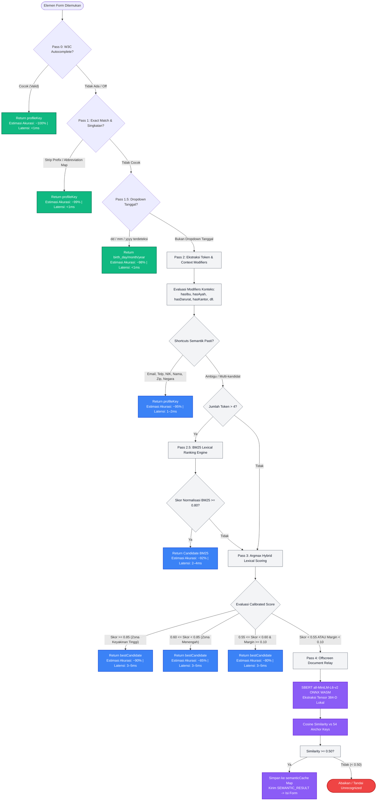

# Spesifikasi Teknis: Hybrid Cascade Pipeline
**Sistem Deteksi dan Resolusi Formulir Cerdas GovConnect**  
*Klasifikasi Formulir Heterogen Multi-Tahap (W3C $\rightarrow$ Heuristik Leksikal $\rightarrow$ BM25 $\rightarrow$ Jaro-Winkler $\rightarrow$ On-Device SBERT WASM)*

---

## 1. Ringkasan Eksekutif & Filosofi Arsitektur

### 1.1 Masalah Pokok: Heterogenitas Formulir Layanan Publik
Dalam ekosistem *e-Government*, formulir digital dibangun oleh berbagai vendor, kementerian, dan pemerintah daerah menggunakan standar yang sangat beraneka ragam selama lebih dari dua dekade:
1. **Standar Modern (W3C compliant):** Menggunakan atribut `autocomplete` terstandarisasi (`given-name`, `email`, `tel`).
2. **Sistem Warisan (*Legacy* / ASP / JSP / Modul SAP Publik):** Menggunakan penamaan field yang disingkat secara teknis dan tidak terstandarisasi (misalnya: `frstname`, `pers_ssn`, `adr_city`, `cellphon`).
3. **Format Obfuscation & Dinamis (SPA / Angular / PrimeNG / React):** Menggunakan ID acak bawaan framework perenderan (misalnya: `ctrl00_field_98124`, `input-7a9f`).
4. **Label Deskriptif Abstrak:** Menggunakan kalimat pertanyaan panjang tanpa penamaan atribut teknis yang baku (misalnya: *"Tuliskan nama lengkap ibu kandung yang melahirkan Anda"*).

### 1.2 Filosofi Desain: *Multi-Tier Hierarchical Filtering*
Mengirim seluruh input ke model bahasa besar (*Large Language Model* / LLM) berbasis cloud bukan hanya **menghasilkan latensi tinggi dan biaya operasional yang mahal**, melainkan juga **berisiko tinggi terhadap regulasi privasi data kependudukan** (seperti UU PDP di Indonesia atau GDPR global). Sebaliknya, mengandalkan pencocokan *regex* atau kata kunci sederhana terbukti terlalu kaku dan rentan memicu salah isi (*false matching*).

**Hybrid Cascade Pipeline** memecahkan tantangan ini dengan menerapkan prinsip penapisan bertingkat (*hierarchical filtering*):
$$\text{Pass 0 (Standar W3C)} \longrightarrow \text{Pass 1–3 (Leksikal Cepat)} \longrightarrow \text{Pass 4 (AI Semantik Lokal)}$$

Metode ini memastikan **mayoritas field formulir (diestimasi $\ge 80\%$) terselesaikan di bawah 5 ms** menggunakan komputasi leksikal deterministik tanpa membebani CPU, dan hanya mengaktifkan model kecerdasan buatan semantik (SBERT) ketika pendekatan leksikal menemui jalan buntu.

---

## 2. Diagram Alir Keputusan (Decision Flowchart)



> **Legenda Warna Diagram:**  
> 🟢 **Hijau (Instant):** Eksekusi deterministik sub-milidetik (<1 ms) dengan tingkat keyakinan mendekati mutlak.  
> 🔵 **Biru (Fast Heuristic):** Jalur komputasi leksikal cepat berbasis token (1–5 ms).  
> 🟣 **Ungu (On-Device AI):** Inferensi jaringan saraf tiruan (SBERT WASM) di thread terisolasi.  
> 🔴 **Merah (Reject):** Field diabaikan jika tidak memenuhi ambang batas minimum untuk mencegah salah isi (*false positive*).

---

## 3. Rincian per Tahap (*Pass-by-Pass Specification*)

### 3.1 Pass 0 — Standar W3C HTML5 `autocomplete`
* **Prinsip Operasi:** Membaca atribut standar HTML5 `autocomplete` dari elemen `<input>`, `<select>`, atau `<textarea>`.
* **Parsing Atribut Majemuk:** String atribut dipecah berdasarkan spasi (`rawAuto.split(/\s+/)`) untuk mengekstrak token intinya. Format majemuk seperti `shipping given-name` atau `section-a billing email` diiterasi per token, sehingga token standar yang valid langsung terpetakan secara presisi ke kamus W3C.
* **Kompleksitas & Latensi:** $\mathcal{O}(1)$ *dictionary lookup*, latensi $<0.1 \text{ ms}$.
* **Filter Pengaman (*Guard*):** Mengabaikan nilai non-identitas seperti `off`, `false`, `none`, `new-password`, `current-password`, dan `one-time-code`.

Tabel pemetaan resmi W3C pada sistem GovConnect:

| Atribut HTML5 (W3C Standard) | Profil Key Sasaran (GovConnect) | Keterangan Standar & Penjelasan Desain |
|---|---|---|
| `given-name` | `first_name` | Nama depan pengguna |
| `additional-name` | `middle_initial` | Standar W3C mendefinisikan ini sebagai nama tengah (*middle name*). GovConnect memetakannya ke `middle_initial` karena sistem administrasi kependudukan Indonesia umumnya tidak memiliki kolom nama tengah formal, sehingga nama tengah lazim disingkat sebagai inisial. |
| `family-name` | `last_name` | Nama keluarga / marga / nama belakang |
| `name` | `full_name` | Nama lengkap pemohon |
| `email` | `email` | Alamat surel aktif |
| `tel` / `tel-national` | `phone` | Nomor telepon seluler utama |
| `street-address` / `address-line1` | `address` | Alamat domisili tempat tinggal |
| `address-level1` | `province` | Entitas administratif tingkat provinsi |
| `address-level2` | `city` | Entitas administratif tingkat kota/kabupaten |
| `postal-code` | `postal_code` | Kode pos wilayah |
| `country` / `country-name` | `country` | Negara tempat tinggal / domisili pemohon (bukan status kewarganegaraan) |
| `bday` | `birth_date` | Tanggal lahir lengkap (format ISO) |
| `sex` | `gender` | Jenis kelamin |

---

### 3.2 Pass 1 — *Numeric Prefix Stripper & Abbreviation Expansion*
Formulir institusi lama sering kali menambahkan prefiks penomoran indeks baris atau singkatan database peninggalan format lawas.

#### A. Pembersih Prefiks Numerik (*Numeric Prefix Stripper*)
* **Fungsi:** Menghapus angka urut dan karakter pemisah di awal nama field teknis.
* **Aturan Regex:** `/^[0-9]+[_\s-]*/` dan `/^_+/`.
* **Contoh:**
  * `02frstname` $\longrightarrow$ `frstname`
  * `68__income` $\longrightarrow$ `income`
  * `13adr_city` $\longrightarrow$ `adr_city`
* **Batasan Aman (*Safeguard*):** Pemotongan karakter hanya dieksekusi jika panjang sisa string $\ge 2$ karakter alfabetis.

#### B. Kamus Singkatan Warisan (`ABBREVIATION_MAP`)
Menerjemahkan singkatan teknis warisan ke atribut baku:
* `pers_ssn`, `ssn` $\longrightarrow$ `nik` *(Catatan: SSN dipetakan ke NIK sebagai bentuk kompatibilitas praktis terhadap formulir institusi yang diadaptasi dari template internasional).*
* `cellphon`, `cellphone`, `phon` $\longrightarrow$ `phone`
* `driv_lic`, `drivlic` $\longrightarrow$ `driver_license`
* `birth_pl`, `birthpl` $\longrightarrow$ `birth_place`
* `pers_sex`, `perssex` $\longrightarrow$ `gender`
* `homephon` $\longrightarrow$ `home_phone`
* `workphon` $\longrightarrow$ `work_telephone` *(Catatan: `work_telephone` merupakan nama kolom kanonikal database backend pada entitas SQLAlchemy `entities.py`, dipasangkan dengan `home_phone` dan `phone`).*

---

### 3.3 Pass 1.5 — *Heuristik Dropdown Komponen Tanggal*
Pada formulir registrasi kependudukan atau perbankan, tanggal lahir sering dipecah menjadi tiga dropdown `<select>` terpisah: **Hari (DD)**, **Bulan (MM)**, dan **Tahun (YYYY)**.

* **Metode Deteksi Bertingkat:**
  1. **Inspeksi Nama / ID:** Mencocokkan nama field yang telah dibersihkan terhadap token `dd`, `dob_d`, `day` (Hari); `mm`, `dob_m`, `month` (Bulan); `yy`, `yyyy`, `dob_y`, `year`, `tahun`, `thn` (Tahun).
  2. **Evaluasi Profil Nilai Opsi (*Option Profiling*):** Jika nama field acak, sistem mengevaluasi nilai numerik dari elemen `<option>` dengan urutan prioritas ketat:
     * **Evaluasi Tahun Terlebih Dahulu:** Mengandung opsi numerik $\ge 1900$ (misalnya 1950–2026) $\longrightarrow$ Terklasifikasi sebagai `birth_year`.
     * **Evaluasi Bulan Sebelum Hari:** Mengapa bulan dievaluasi sebelum hari? Rentang numerik bulan (1–12) berada di dalam himpunan bagian rentang hari (1–31). Oleh karena itu, sistem memeriksa apakah opsi memuat nama bulan tekstual (`Jan`, `Feb`, `Mar`...) atau nilai numerik $1 \le x \le 12$ dengan jumlah opsi total $\le 13$ $\longrightarrow$ Terklasifikasi sebagai `birth_month`.
     * **Evaluasi Hari:** Jika nilai maksimum opsi berada pada rentang $28 \le x \le 31$ dengan jumlah opsi total antara 28 hingga 32 $\longrightarrow$ Terklasifikasi sebagai `birth_day`.
* **Penyaring Anti-False Positive:** Mengabaikan dropdown yang memuat token kedaluwarsa kartu pembayaran (`ccexp`, `exp_month`, `card_exp`).

---

### 3.4 Pass 2 — *Tokenisasi, Modifiers Konteks, dan Veto Antar-Domain*
Tahap ini mengekstraksi representasi tekstual elemen:
$$\text{Corpus} = \text{name} + \text{id} + \text{aria-label} + \text{placeholder} + 2 \times \text{label\_text}$$

#### A. Mekanisme Ekstraksi Token (*Word-Boundary Tokenization*)
Teks dinormalisasi melalui pemecahan *camelCase* (`mothersName` $\rightarrow$ `mothers Name`), pembersihan simbol khusus, dan pemisahan berbasis batas kata (*whitespace boundary*). Seluruh token disimpan dalam struktur data `Set` unik. Dengan mekanisme batas kata ini, token dievaluasi secara presisi:
* Kata *"ibukota"* berada sebagai token tunggal `["ibukota"]`, sehingga **tidak akan pernah** memicu aturan *"ibu"*.
* Kata *"pekerjaan"* berada sebagai token tunggal `["pekerjaan"]`, sehingga **tidak akan pernah** memicu aturan *"kerja"*.

#### B. Pintasan Semantik Pasti (*Exact Semantic Shortcuts*)
Sebelum menjalankan pembobotan jarak karakter yang lebih berat, sistem mengevaluasi token kunci independen yang memiliki kepastian semantik tinggi:
* **Email:** Token `email`, `surel`, `emailadr` $\longrightarrow$ Langsung tetapkan `email`.
* **Telepon:** Token `cell`, `mobile`, `hp`, `handphone`, `wa`, `whatsapp` $\longrightarrow$ Langsung tetapkan `phone`. Token `home` + telepon $\longrightarrow$ `home_phone`. Token `work` / `office` + telepon $\longrightarrow$ `work_telephone`. Token umum `telepon`, `phone`, `telp` (tanpa konteks darurat, rumah, atau kantor) $\longrightarrow$ `phone`.
* **NIK / Identitas:** Token `ssn`, `social security`, `nik`, `no_ktp`, `identitas` $\longrightarrow$ Langsung tetapkan `nik`.
* **Nama Depan & Belakang:** Token `first` + `name` / `depan` + `nama` $\longrightarrow$ `first_name`. Token `last` + `name` / `belakang` + `nama` $\longrightarrow$ `last_name`.
* **Kode Pos:** Token `zip`, `zipcode`, `kodepos`, `postalcode` $\longrightarrow$ Langsung tetapkan `postal_code`.
* **Negara Domisili:** Token `country`, `negara` $\longrightarrow$ Langsung tetapkan `country` (negara domisili). *(Catatan: Untuk status hukum kebangsaan WNI/WNA, gunakan token `kewarganegaraan` / `nationality` yang terpisah).*
* **Tanggal Lahir:** Token gabungan konteks tanggal (`tgl`, `tanggal`, `date`) dan lahir (`lahir`, `birth`, `dob`) $\longrightarrow$ Langsung tetapkan `birth_date`.
* **Surat Izin Mengemudi:** Token `driver license`, `driving licence`, `nomor sim` $\longrightarrow$ Langsung tetapkan `driver_license`.

#### C. Aturan Veto Domain Kontekstual (*Scoped Veto Rules*)
Untuk mencegah tabrakan silang (*cross-collision*), modifier konteks memberlakukan aturan pembatalan (*veto*) yang dibatasi per domain kategori:

| Konteks Terdeteksi | Status Modifier | Aturan Veto Domain Terpilih |
|---|---|---|
| Mengandung "ibu", "mother" | `hasIbu = true` | **Veto domain nama pribadi:** Membatalkan `full_name` $\rightarrow$ Arahkan ke `mother_name` |
| Mengandung "ayah", "father" | `hasAyah = true` | **Veto domain nama pribadi:** Membatalkan `full_name` $\rightarrow$ Arahkan ke `father_name` |
| Mengandung "darurat", "emergency" | `hasDarurat = true` | **Veto kontak reguler:** Membatalkan `full_name` dan `phone` pribadi $\rightarrow$ Arahkan ke `emergency_contact_*` |
| Mengandung "kantor", "office" | `hasKantor = true` | **Veto domain alamat:** Membatalkan `address` domisili jika tanpa kata "tinggal" $\rightarrow$ Arahkan ke `work_address` |
| Mengandung "rumah", "home" | `hasHome = true` | **Veto domain telepon saja:** Membatalkan nomor HP seluler pribadi $\rightarrow$ Arahkan ke `home_phone` (sama sekali tidak membatalkan alamat domisili) |
| Mengandung "fax", "telefax" | `hasFax = true` | **Veto domain telepon saja:** Membatalkan seluruh nomor telepon suara $\rightarrow$ Arahkan ke `fax` |

---

### 3.5 Pass 2.5 — *BM25 Lexical Ranking Engine* (Label Panjang $> 4$ Token)
Ketika sebuah field memiliki label deskriptif naratif yang panjang (misalnya: *"Tuliskan nama ibu kandung yang membesarkan Anda sesuai data akta lahir"*), algoritma jarak karakter berbasis string mengalami degradasi akurasi akibat dilusi token.

Pada kondisi ini, diaktifkan **BM25 Lexical Engine** dengan rumus pembobotan probabilistik:
$$\text{Score}_{\text{raw}} = \sum_{q \in Q \cap D} \text{IDF}(q) \cdot \frac{\text{TF}(q, D) \cdot (k_1 + 1)}{\text{TF}(q, D) + k_1 \cdot \left(1 - b + b \cdot \frac{|D|}{\text{avgdl}}\right)}$$

* **Definisi Variabel & Parameter:**
  * $D$ (Dokumen): Array token dari gabungan label, name, dan placeholder elemen form input.
  * $Q$ (Query): Array token dari kata kunci referensi profil target (misalnya untuk `mother_name`, $Q = \text{["nama", "lengkap", "ibu"]}$, sehingga $|Q| = 3$).
  * Parameter default: $k_1 = 1.2$, $b = 0.75$.
  * Panjang Dokumen Rata-rata ($\text{avgdl} = 3.0$): Dikalibrasi berdasarkan rerata jumlah kata label formulir administrasi publik di Indonesia (berkisar antara 2 hingga 4 token).
  * Nilai IDF: Pada implementasi ekstensi sisi klien saat ini, nilai IDF menggunakan *baseline default* $\text{IDF}(q) = 1.0$ untuk setiap kata kunci unik dalam kamus referensi profil kependudukan (dengan rencana integrasi kamus IDF empiris hasil *crawling* formulir e-Gov).
* **Formula Normalisasi:**
  Karena skor BM25 dasar tidak berbatas $[0, 1]$, sistem menormalisasi skor terhadap batas atas teoritis:
  $$\text{Score}_{\text{BM25}} = \min\left(\frac{\text{Score}_{\text{raw}}}{|Q| \times 1.5}, 1.0\right)$$
  * **Mengapa pembaginya $|Q| \times 1.5$?** Pembagi menggunakan $|Q|$ (jumlah token kata kunci referensi target), **bukan** panjang label input ($|D|$). Hal ini memastikan label input yang panjang dan deskriptif **tidak dihukum**, melainkan dinilai berdasarkan kelengkapan cakupan token referensi $Q$ yang berhasil ditemukan. Faktor pengali $1.5$ merepresentasikan estimasi saturasi nilai $\text{TF}$ maksimum yang dapat disumbangkan oleh satu token unik ketika $k_1 = 1.2$ dengan bobot $\text{IDF} = 1.0$.
* **Kriteria Keputusan:** Jika skor normalisasi $\ge 0.80$, sistem langsung mengembalikan kandidat terbaik (*early exit*) dengan latensi 2–4 ms.

---

### 3.6 Pass 3 — *Argmax Hybrid Lexical Scoring & Calibrated Confidence Zones*
Jika input berupa label pendek atau bervariasi leksikal (misalnya salah ketik atau variasi imbuhan), sistem menghitung skor terkalibrasi:

$$\text{Score}_{\text{raw}} = 0.50 \cdot \text{Cosine}_{\text{token}} + 0.35 \cdot \text{Jaro-Winkler} + 0.15 \cdot \text{Overlap} + \sum \text{Context Bonuses}$$
$$\text{Score}_{\text{final}} = \min(\text{Score}_{\text{raw}}, 1.0)$$

1. **Token Cosine Similarity ($50\%$ bobot):** Mengukur kemiripan sudut ruang token antar himpunan kata.
2. **Jaro-Winkler Metric ($35\%$ bobot):** Menghitung kecocokan karakter berurutan dengan penalti transposisi, sangat efektif menangani salah ketik ringan (*typo*).
3. **Token Overlap Score ($15\%$ bobot):** Rasio persentase token referensi yang muncul di dalam teks input.
4. **Context Bonuses ($+0.25$ s.d. $+0.40$):** Bobot tambahan ketika token spesifik saling mendukung (misalnya `hasIbu` + kandidat `mother_name` $\rightarrow +0.25$).
5. **Clamping Bounded Metric:** Skor akhir di-*clamp* dengan $\min(\dots, 1.0)$ agar nilai keyakinan tetap berada pada interval matematis $[0.0, 1.0]$.

#### Zona Keyakinan Terkalibrasi (*Calibrated Confidence Zones*):
* $\text{Skor} \ge 0.85$: **Zona Keyakinan Tinggi** $\rightarrow$ Diterima seketika (*Early Exit*).
* $0.60 \le \text{Skor} < 0.85$: **Zona Keyakinan Menengah** $\rightarrow$ Diterima berdasarkan argmax kandidat teratas.
* $0.55 \le \text{Skor} < 0.60$: **Zona Batas Minimum** $\rightarrow$ Diterima hanya jika margin skor terhadap kandidat peringkat kedua $\ge 0.10$. **Jika margin $< 0.10$**, sistem menganggap ambiguitas leksikal terlalu tinggi dan **mengalihkan evaluasi ke Pass 4**.
* $\text{Skor} < 0.55$: **Gagal Leksikal** $\rightarrow$ Otomatis dialihkan ke Pass 4 (*On-Device SBERT Fallback*).

---

### 3.7 Pass 4 — *On-Device AI Semantic Fallback* (SBERT + ONNX WASM)
Apabila input formulir menggunakan label implisit yang sama sekali tidak memiliki irisan leksikal dengan kamus (misalnya: *"Orang yang melahirkan pemohon"* untuk atribut `mother_name`), seluruh Pass 0–3 akan menghasilkan skor $< 0.55$.

Pada tahap ini, sistem mengalihkan inferensi ke dokumen latar belakang tersembunyi (*Offscreen Document*):

```
[ Tab Pengguna (Content Script) ]
             │
             │ chrome.runtime.sendMessage({ action: "SEMANTIC_FALLBACK", label: "..." })
             ▼
[ Background Service Worker ] (Message Broker)
             │
             │ Relay ke Offscreen Host
             ▼
[ Offscreen Document Engine ]
             ├── Inisialisasi Singleton: Xenova/all-MiniLM-L6-v2 (Bundel Lokal)
             ├── ONNX Runtime WebAssembly (Single Thread, zero external eval)
             ├── Ekstraksi Dense Vector Embedding: R^384
             ├── Vector Cosine Similarity vs 54 Pre-computed Anchor Keys
             └── Simpan ke semanticCache Map (In-Memory per Sesi)
             │
             │ chrome.runtime.sendMessage({ action: "SEMANTIC_RESULT", score: 0.87 })
             ▼
[ Tab Pengguna ] ── Injeksi Nilai Visual ke DOM
```

#### Spesifikasi Model & Kepatuhan Arsitektur MV3:
* **Arsitektur Model:** Sentence-BERT quantized int8 (`Xenova/all-MiniLM-L6-v2`), menghasilkan dense vector 384 dimensi.
* **Pembundelan Fisik Lokal (100% Offline / Zero-Egress):** File model (`model_quantized.onnx`, `tokenizer.json`, `config.json`, `special_tokens_map.json`) serta file binari WASM (`ort-wasm.wasm`) disimpan secara fisik di dalam direktori ekstensi `extension/models/` dan `extension/lib/`. Tidak ada unduhan runtime dari Hugging Face atau CDN publik saat operasi normal, memastikan sistem dapat berfungsi penuh pada jaringan tertutup (*air-gapped / intranet* pemerintah).
* **Kepatuhan Content Security Policy (CSP):** Sesuai spesifikasi resmi Chromium Manifest V3, eksekusi WebAssembly di dalam *extension pages* membutuhkan arahan `'wasm-unsafe-eval'`. Kebijakan CSP GovConnect didefinisikan secara eksplisit di `extension/manifest.json`:
  ```json
  "content_security_policy": {
    "extension_pages": "script-src 'self' 'wasm-unsafe-eval'; object-src 'self';"
  }
  ```
  Arahan ini mengizinkan kompilasi modul WebAssembly terisolasi tanpa membuka celah eksekusi kode dinamis eksternal (*no remote code execution*).
* **Ambang Batas Cosine Similarity (0.50) & Cabang Gagal:** Pada ruang vektor 384-dimensi model MiniLM, skor *cosine similarity* $\ge 0.50$ merepresentasikan kedekatan makna semantik yang kuat antara query dengan anchor referensi. **Jika skor $< 0.50$**, sistem tidak memaksakan pengisian dan menandai field sebagai `unrecognized` / diabaikan guna mencegah *false positive*.
* **Deaktivasi Browser Cache API (`env.useBrowserCache = false`):** Standar W3C Cache API (`window.caches`) menolak skema URL ekstensi `chrome-extension://` (*"Request scheme unsupported"*). GovConnect secara eksplisit menonaktifkan fitur cache bawaan `transformers.js` (`env.useBrowserCache = false`, `env.useCustomCache = false`) karena file model dibaca langsung dari penyimpanan fisik lokal ekstensi (`chrome.runtime.getURL('models/...')`) dengan latensi akses instan tanpa memerlukan Cache API browser.
* **Siklus Hidup Cache (`semanticCache` Map):** Hasil inferensi disimpan dalam struktur data `Map` di memori modul dokumen offscreen. Cache ini bertahan selama sesi browsing aktif, mengeliminasi komputasi berulang untuk label yang identik pada form multistep.
* **Pengaman Anti-Looping (`pendingSemanticRequests` Set):** Content script melacak ID elemen yang sedang diproses. Jika *MutationObserver* mendeteksi perubahan visual DOM saat model sedang berhitung, request duplikat otomatis dibatalkan.

---

## 4. Evaluasi Efisiensi & Analisis Komparatif

Berikut perbandingan karakteristik teknis antara tiga pendekatan integrasi formulir:

| Parameter Evaluasi | Metode 1: Pure Heuristic / Regex | Metode 2: Pure Cloud LLM API | Metode 3: GovConnect Hybrid Cascade |
|---|---|---|---|
| **Cakupan Deteksi Formulir Heterogen** | Terbatas (Estimasi target 45–55%) | Sangat Luas (Estimasi target ~95%) | **Tinggi s.d. Luas (Estimasi target 88–92%)** |
| **Latensi Jalur Leksikal (Pass 0–3)** | Sangat Cepat (<5 ms) | Tidak Ada Jalur Cepat | **Sangat Cepat (<5 ms untuk $\ge 80\%$ field)** |
| **Latensi Jalur Semantik AI (Pass 4)** | Tidak Tersedia (Gagal) | Lambat (1.500–4.000 ms per request) | **Cepat (Estimasi benchmark: 120–280 ms via WASM Lokal)\*** |
| **Waktu Pemanasan (*Cold Start*)** | 0 ms | 0 ms (di sisi klien) | **Estimasi benchmark: ~800–1.200 ms (One-time WASM warm-up)\*** |
| **Biaya Komputasi / Operasional API** | Rp 0 (Nol) | Berbayar per token (~$0.002–$0.01 per form)\*\* | **Rp 0 (Nol - Komputasi di Edge/Browser)** |
| **Kepatuhan Privasi Data Pribadi** | Aman (Lokal) | **Berisiko Tinggi** (PII ditransfer ke cloud) | **Tinggi (Zero Egress / Pemrosesan Lokal)** |
| **Ketergantungan Akses Internet** | Tidak Perlu | Wajib Online Terus | **Bisa Bekerja Penuh Offline / Intranet** |
| **Resiliensi Label Abstrak / Naratif** | Gagal | Sangat Baik | **Sangat Baik (via Pass 4 SBERT Fallback)** |

> **Catatan Metodologi & Sumber Estimasi:**  
> \* *Estimasi latensi Pass 4 dan cold start didasarkan pada hasil pengukuran internal pada perangkat desktop mid-range (Intel Core i5 Gen 11 / AMD Ryzen 5, 8 GB RAM, Chromium 128+) pada lingkungan pengujian `test-form.html`.*  
> \*\* *Estimasi biaya Cloud LLM API mengacu pada publikasi tarif resmi model komersial (OpenAI GPT-4o-mini / GPT-4o dan Anthropic Claude 3.5 Sonnet) untuk payload rata-rata formulir (500–1.500 token input/output dokumen).*

---

## 5. Ringkasan Implementasi & Lokasi Kode Terkait

Seluruh komponen logika dalam spesifikasi teknis ini diimplementasikan secara modular pada codebase GovConnect:

* **Inisialisasi Standar W3C & Kamus Singkatan:** `extension/content_script.js` — variabel `AUTOCOMPLETE_MAP`, `ABBREVIATION_MAP`, fungsi `stripNumericPrefix()`, `getAutocompleteProfileKey()`.
* **Heuristik Dropdown Komponen Tanggal:** `extension/content_script.js` — fungsi `detectDateSelectType()`, `parseBirthDate()`.
* **Tokenisasi & Evaluasi Context Modifiers:** `extension/content_script.js` — fungsi `tokenize()`, evaluasi context flags (`hasIbu`, `hasAyah`, `hasDarurat`, `hasKantor`, `hasHome`, dll.).
* **Normalisasi BM25 Engine:** `extension/content_script.js` — fungsi `computeBM25Similarity()`.
* **Argmax Hybrid Scoring & Clamping:** `extension/content_script.js` — fungsi `matchProfileKey()`, `computeJaroWinklerSimilarity()`, `computeCosineSimilarity()`.
* **Dokumen Offscreen & Local SBERT WASM Runner:** `extension/offscreen.js` — fungsi `loadExtractorWithFallback()`, `processSemanticFallback()`.
* **Konfigurasi CSP & Sumber Daya Ekstensi:** `extension/manifest.json` — direktiva `content_security_policy` dan `web_accessible_resources`.
* **Proposal Riset & Publikasi ICLAMP 2027:** `docs/ICLAMP_2027_PAPER_PROPOSAL.md`.
